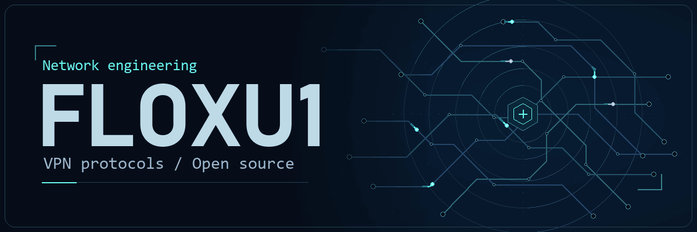
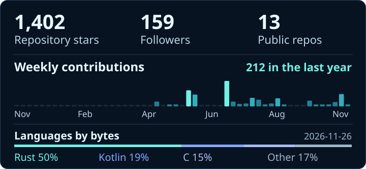

<picture>
  <source media="(prefers-reduced-motion: reduce)" srcset="assets/banner-static.png">
  
</picture>

## Open-source network engineer & VPN developer

I build privacy-focused VPN clients and routing tools for Android and Windows. My work spans Rust networking, Android VPN architecture, and Xray integration, with ongoing research into QUIC and MASQUE for censorship-resistant networking.

[Browse repositories](https://github.com/Floxu1?tab=repositories) · [UAC on Telegram](https://t.me/UacSniSpoofer)

<picture>
  <source media="(prefers-reduced-motion: reduce)" srcset="assets/terminal-static.png">
  
</picture>

## Selected projects

<a href="https://github.com/Floxu1/UAC-SNI-Spoofer-Android">
  <picture>
    <source media="(prefers-reduced-motion: reduce)" srcset="assets/projects/android.png">
    
  </picture>
</a>

### [UAC SNI Spoofer for Android](https://github.com/Floxu1/UAC-SNI-Spoofer-Android)

An Android VPN client built on `VpnService` and a native TUN bridge. It brings Xray, Tor and a Rust-powered Aether transport into one Jetpack Compose interface.

`Kotlin` · `Rust` · `Xray` &nbsp; 

<a href="https://github.com/Floxu1/UAC-SNI-Spoofer-Windows">
  <picture>
    <source media="(prefers-reduced-motion: reduce)" srcset="assets/projects/windows.png">
    
  </picture>
</a>

### [UAC SNI Spoofer for Windows](https://github.com/Floxu1/UAC-SNI-Spoofer-Windows)

A Windows desktop client for rule-based routing, Xray connections and live system proxy control. It supports both system proxy and TUN modes.

`Python` · `PySide6` · `Xray` &nbsp; 

### [UAC Gateway](https://github.com/Floxu1/UAC-GATEWAY)

Shares a Windows VPN route or local proxy with TVs and other LAN devices. It detects network adapters and shows the settings each device needs.

`Python` · `PySide6` · `WinNAT` &nbsp; 

### [Behroozuac V2Ray for Android TV](https://github.com/Floxu1/BehroozuacV2ray-Android-TV)

A v2rayNG-based client for Android TV. Add configurations from a phone or by QR code and let the TV pick a connection using real latency tests.

`Kotlin` · `Android TV` · `V2Ray` &nbsp; 

## Open-source activity

<picture>
  <source media="(prefers-reduced-motion: reduce) and (prefers-color-scheme: dark)" srcset="https://raw.githubusercontent.com/Floxu1/Floxu1/refs/heads/profile-assets/assets/activity/snake-dark.png">
  <source media="(prefers-reduced-motion: reduce)" srcset="https://raw.githubusercontent.com/Floxu1/Floxu1/refs/heads/profile-assets/assets/activity/snake-light.png">
  <source media="(prefers-color-scheme: dark)" srcset="https://raw.githubusercontent.com/Floxu1/Floxu1/refs/heads/profile-assets/assets/activity/snake-dark.gif">
  
</picture>

The daily snapshot uses public GitHub data. Language shares use bytes from public non-fork repositories.

[GitHub activity](https://github.com/Floxu1?tab=overview) · [Followers](https://github.com/Floxu1?tab=followers) · [Achievements](https://github.com/Floxu1?tab=achievements)
